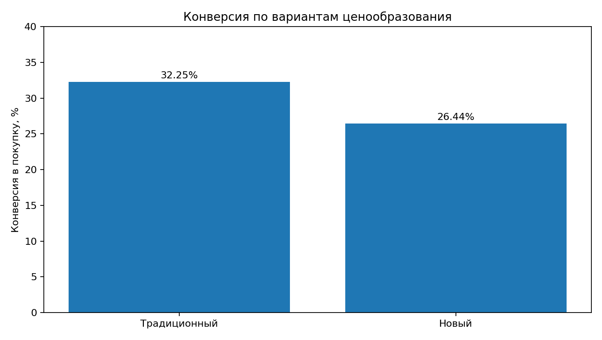
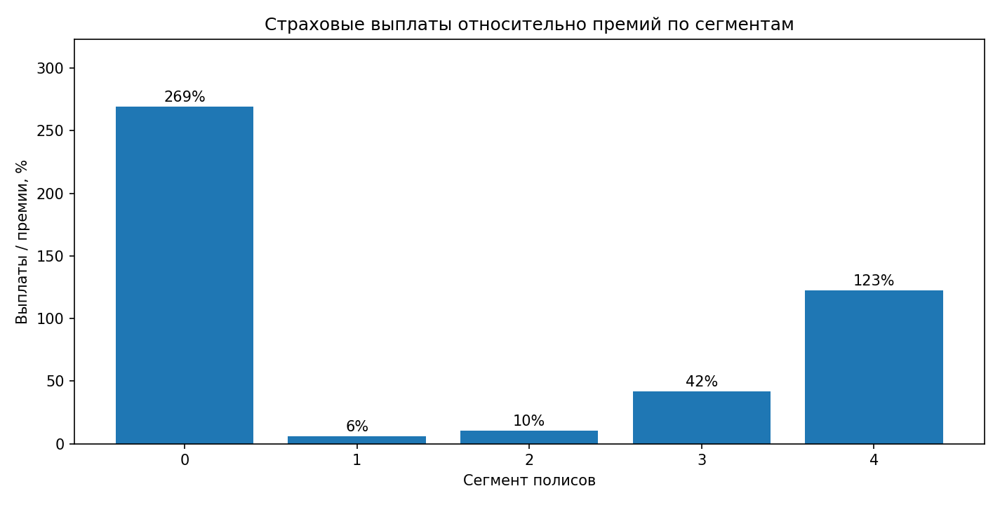

# Страхование путешественников: сегментация портфеля и проверка нового тарифа

**Стоит ли менять стоимость полисов на основе клиентских сегментов?**

В исследовании рассматривается страховой портфель путешественников: данные о клиентах, полисах, страховых выплатах и результатах A/B-теста двух подходов к ценообразованию. Цель – определить различия между сегментами и оценить, улучшает ли новый тариф конверсию и финансовый результат.

## Главное решение

**Новый тариф пока не стоит распространять на всех клиентов.** Конверсия в покупку снизилась статистически значимо; преимущество по финансовому результату на клиента не подтверждено.

| Метрика A/B-теста | Старый тариф | Новый тариф |
|---|---:|---:|
| Клиентов | 6 043 | 6 306 |
| Конверсия в покупку | **32,25%** | **26,44%** |
| Средняя цена купленного полиса | 4 155 ₽ | 5 228 ₽ |
| Премии на клиента | 1 340 ₽ | 1 382 ₽ |
| Результат после выплат на клиента | 284 ₽ | 836 ₽ |
| Выплаты / страховые премии | 78,79% | 39,47% |

**Разница конверсии – −5,82 п.п.** (p = 1,26 × 10⁻¹²). Цена оформленного полиса выросла на **25,8%** (p = 0,0104). Изменение премий на клиента (p = 0,739) и финансового результата после выплат (p = 0,235) статистически не подтверждено.

## Сегментация и качество данных

В портфеле **3 711 полисов** и **45 записей с положительными выплатами**. Для анализа выделено пять групп по возрасту, сроку, стоимости полиса и страховой сумме. Показатели выплат по сегментам существенно различаются, но отдельных случаев мало для окончательных выводов о риске.

Проверка качества выявила **193 записи, отмеченные как аномальные**. Среди них оказались **все 45 полисов с выплатами**. Удалять такие строки при исследовании убыточности нельзя: это полностью исключило бы страховые случаи из выборки. Поэтому записи сохранены, а признак аномалии рассматривается отдельно от признаков сегментации.

## Что делать дальше

Проверить причины падения конверсии, **2 493 записи без обозначенной группы A/B-теста**, валюту страховых выплат и качество регистрации событий. После уточнения данных можно доработать тариф и повторить эксперимент. При масштабировании учитывать не только цену купленного полиса, но и конверсию, премии и финансовый результат на клиента.

## Материалы

- [Анализ страхового портфеля, кластеризация и A/B-тест](analysis.ipynb) – воспроизводимые расчёты и выводы.
- [Аналитический отчёт](report.pdf) – ключевые результаты, методика и ограничения.
- [Презентация для руководства](presentation.pdf) – решение по новому тарифу.
- `CASE_CLIENTS.xlsx`, `CASE_CONTRACTS.xlsx`, `CASE_LOSSES.xlsx` – сведения о клиентах, договорах и выплатах.
- `policies_cleaned.xlsx` – подготовленная витрина с признаком аномалии; `experiment_group.xlsx` – распределение клиентов по вариантам тарифа.

Для запуска ноутбука нужны `pandas`, `numpy`, `matplotlib`, `scipy`, `scikit-learn` и `openpyxl`. Запускайте его из корня репозитория.
